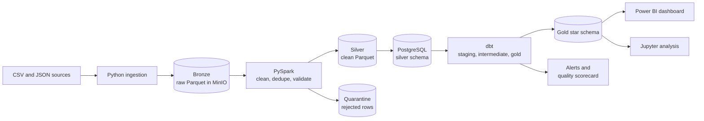
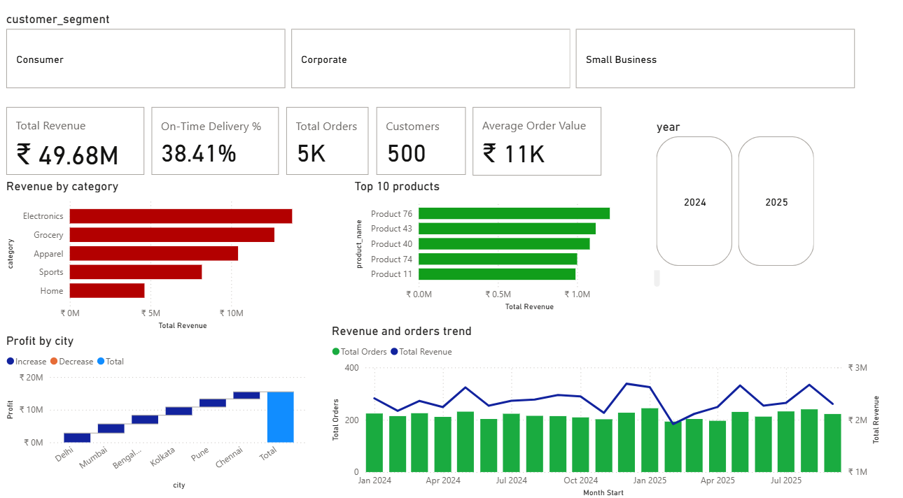
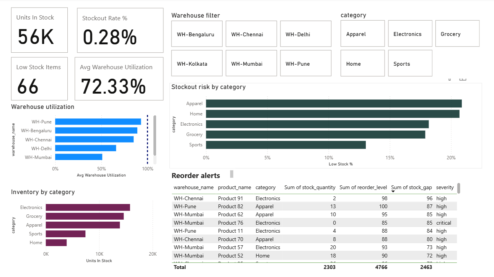
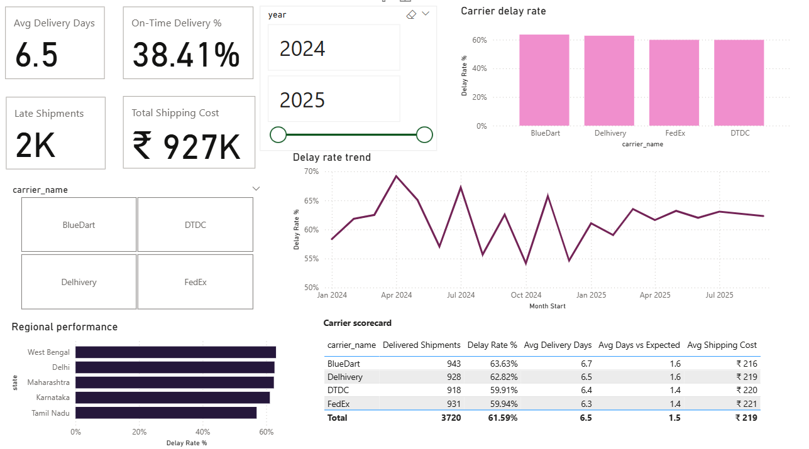
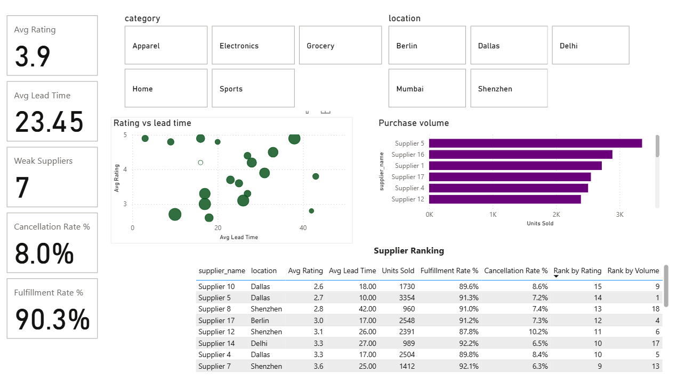

# SupplyChain360

End-to-end supply chain data engineering and analytics platform. Raw files go in; a tested star schema and a four-page Power BI dashboard come out, orchestrated daily by Airflow.

> The goal is not only to analyze supply-chain data, but to engineer the platform that makes the analysis trustworthy.

## What it does

SupplyChain360 simulates how a company collects data from suppliers, warehouses, inventory systems, customers, orders and carriers. Python lands the raw data in a data lake, PySpark cleans it and quarantines bad records, dbt builds and tests a dimensional model in PostgreSQL, and Power BI turns it into business insight. Everything runs in Docker and is scheduled by Airflow.

## Architecture



Airflow runs the flow every day at 06:00 UTC:
`ingest_to_bronze → bronze_to_silver → silver_to_postgres → quality_to_postgres → dbt_build → alert_summary → dbt_docs`

## Tech stack

| Component | Technology |
|---|---|
| Language | Python |
| Orchestration | Apache Airflow 3 |
| Processing | PySpark 3.5 (local mode) |
| Data lake | MinIO (S3 compatible), Parquet |
| Warehouse | PostgreSQL 16, star schema |
| Transformation and tests | dbt Core 1.11 |
| Analysis | Jupyter Notebook |
| Visualization | Power BI |
| Containers | Docker Compose |

## Dashboard






## Results from the sample data

- 4,570 completed or open orders, 500 customers and ₹49.68M revenue (cancelled orders excluded)
- On-time delivery of 38.4%; average delivery takes 6.5 days
- 66 low-stock alerts, one stockout, and 7 suppliers rated below the 3.5 threshold
- 35 bad records quarantined and 20 duplicate orders removed, with every row reconciled

## Data quality

Bad data is caught at three levels and never silently dropped:

1. **Spark** validates each table. Duplicates are removed and counted. Invalid rows (missing customer, negative quantity, delivery before shipment) go to quarantine with the failed rule attached, so one bad row never blocks 5,000 good ones.
2. **dbt** runs 70+ tests: unique, not null, relationships, accepted values, business rules and a row-count reconciliation (raw = duplicates + silver + quarantine). Known problems, such as order lines of quarantined orders, are warnings; lost rows fail the build.
3. **Airflow** retries failed tasks twice and records any final failure in `quality.pipeline_failures`.

Business alerts (low stock, late delivery, weak suppliers) are dbt models in the `alerts` schema. Thresholds live in `dbt/dbt_project.yml`.


## Repository layout

```
SupplyChain360/
├── airflow/dags/        the daily pipeline DAG
├── data/                sample data generator
├── dbt/                 staging, intermediate, marts, alerts, quality models and tests
├── docker/              compose file, Airflow image, Postgres setup script
├── docs/                data dictionary, pipeline guide, dashboard screenshots
├── ingestion/           Python ingestion into the Bronze layer
├── notebooks/           business analysis in Jupyter
├── quality/validation/  alert summary script
├── spark/               PySpark jobs and shared helpers
├── warehouse/           hand-built star schema SQL (reference version)
└── dashboard/           Power BI file
```

## Design decisions and trade-offs

- **Spark in local mode** inside the Airflow container keeps the whole platform runnable on an 8 GB laptop. The same code moves to a cluster by changing the master URL.
- **Spark cleans files, dbt models the warehouse.** Each tool does what it is best at.
- **Idempotent jobs.** Every step overwrites its own output, so retries and reruns are safe.
- **MinIO via a mirror image.** MinIO's official image is no longer published on Docker Hub, so the project uses a mirror of its last release. Moving to AWS S3 means changing the endpoint and credentials.
- **Postgres published on port 5433** so it never collides with a Postgres installed on the host.
- **Hash surrogate keys** (md5 of the business key), so dimensions and facts agree without lookups.

## Known limitations

- The data is generated, so groups differ only slightly (for example, carriers).
- Profit in `fact_sales` is revenue minus product cost. Shipping cost is not allocated to order lines.
- Batch only. Power BI is an Import snapshot, so click **Refresh** after a pipeline run.

## Documentation

- [Data dictionary](docs/data_dictionary.md)
- [Pipeline documentation](docs/pipeline_documentation.md)